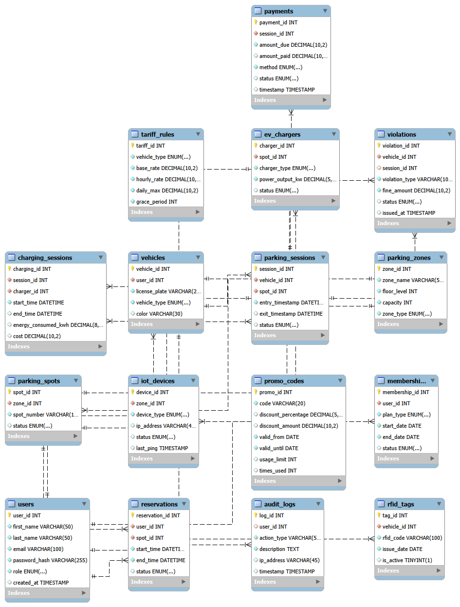
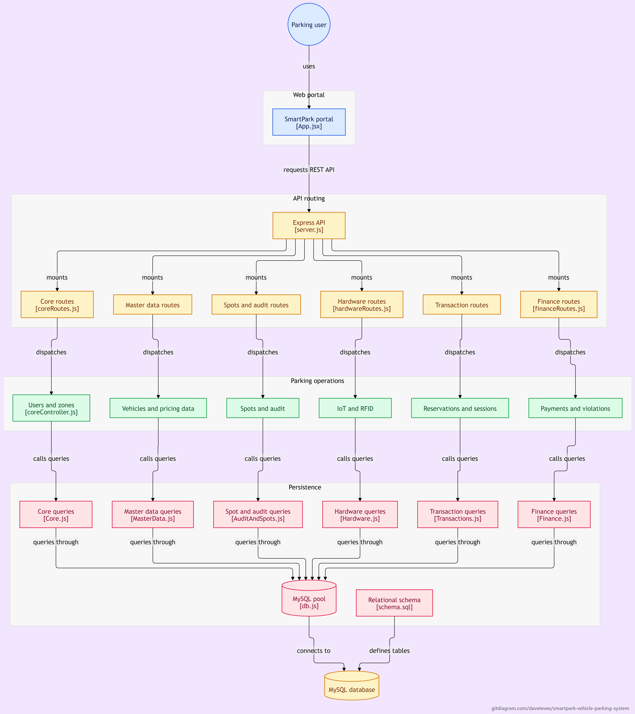

# SmartPark Vehicle Parking System

Automated, real-time parking management and dynamic pricing.

SmartPark is a web-based application developed for **Database Management Systems 1 (DBMS 1)** and **Systems Integration and Architecture (SIA)**. It manages the core parking operations of a facility, including users, vehicles, parking zones and spots, reservations, live parking sessions, tariff rules, promo codes, memberships, payments, violations, IoT devices, RFID tags, EV chargers, charging sessions, and audit logs.

## Table of Contents

- [Group Members](#group-members)
- [Section](#section)
- [Features](#features)
- [Technologies](#technologies)
- [Database Design](#database-design)
- [System Architecture](#system-architecture)
- [Ownership Matrix](#ownership-matrix)
- [API Documentation](#api-documentation)
- [Git Collaboration Rules](#git-collaboration-rules)
- [Getting Started](#getting-started)
- [Important Notes](#important-notes)

## Group Members

| No. | Name |
|:---:|------|
| 1 | Teves, Dave Bryan A. |
| 2 | Teves, Richie |
| 3 | Yugto, Kent |
| 4 | Vargas, Anton Johnrhoan |
| 5 | Tero, Ma. Rudylin |
| 6 | Bermudo, Micha G. |

## Section

<!-- TODO: Replace with your section, e.g., A -->
Section C Group 6

## Features

### Automatic Fee Calculation and Dynamic Pricing

When a vehicle exits a parking spot, SmartPark automatically calculates the parking fee based on:

- The entry and exit timestamps
- The total parking duration
- The configured tariff rules
- Any applicable promo codes and active memberships

This ensures accurate billing, eliminates manual calculation errors, and updates live session records in real time.

## Technologies

| Layer | Technology |
|---|---|
| Frontend | Vite, React |
| Backend | Node.js, Express.js (MVC, no ORM) |
| Database | MySQL (`smartpark_db`) |
| API | REST (JSON) |
| Version Control | Git and GitHub |

## Database Design

SmartPark uses a relational MySQL database that enforces primary keys, foreign keys, and field validation.

### Entity Relationship Diagram



## System Architecture

SmartPark follows a three-tier Express.js MVC architecture:

- **Entry point (`server.js`):** Mounts six modular route handlers: Core, Master Data, Spots & Audit, Hardware, Transactions, and Finance.
- **Controllers and models:** Each route dispatches requests to its corresponding controller and raw-SQL model: `Core.js`, `MasterData.js`, `AuditAndSpots.js`, `Hardware.js`, `Transactions.js`, and `Finance.js`.
- **Persistence layer (`db.js`):** All models query the `smartpark_db` database, defined in `schema.sql`, through a shared MySQL connection pool.

The separate Vite and React frontend consumes this REST API.



## Ownership Matrix

| Member | GitHub | Tables | Endpoints / Screens | Join(s) | Feature Role |
|---|---|---|---|---|---|
| Teves, Dave Bryan A. | [@daveteves](https://github.com/daveteves) | `Users`, `Parking_Zones` | User registration, login/auth flow, zone management CRUD | Users + Vehicles (`INNER JOIN`) | Core |
| Teves, Richie | [@richiefastwheelz](https://github.com/richiefastwheelz) | `Tariff_Rules`, `Promo_Codes`, `Vehicles` | Pricing rule configuration, vehicle registration CRUD | Vehicles + RFID_Tags (`LEFT JOIN`) | Master Data |
| Yugto, Kent | [@Xialc-sudo](https://github.com/Xialc-sudo) | `Memberships`, `Audit_Logs`, `Parking_Spots` | Spot status management, membership subscription tracking | Zones + Spots (`RIGHT JOIN`) | Audit & Spots |
| Vargas, Anton Johnrhoan | [@antonvvargas](https://github.com/antonvvargas) | `IoT_Devices`, `RFID_Tags`, `EV_Chargers` | Device heartbeat tracking, RFID assignment CRUD | Spots + EV_Chargers (`LEFT JOIN`) | Hardware |
| Tero, Ma. Rudylin | [@marudylintero-svg](https://github.com/marudylintero-svg) | `Reservations`, `Parking_Sessions` | Booking flow, live session tracking (entry/exit timestamps) | Sessions + Spots (`INNER JOIN`) | Transactions |
| Bermudo, Micha G. | [@MichaBermudo](https://github.com/MichaBermudo) | `Payments`, `Violations`, `Charging_Sessions` | Payment processing, fine management CRUD | Payments + Violations (`FULL OUTER JOIN` via `UNION`) | Finance |

## API Documentation

Full endpoint routing and request/response specifications are in [`docs/api-endpoints.md`](docs/api-endpoints.md).

## Git Collaboration Rules

1. Work on your own feature branch, named `feature/<name>-<purpose>`.
2. Commit from your own machine with clear messages using prefixes such as `feat:`, `fix:`, `docs:`, and `refactor:`.
3. Open a Pull Request to merge into `main`. Nobody pushes directly to `main`.
4. Have a teammate review every PR before merging.
5. Never commit `.env` files, database passwords, or `node_modules`.

## Getting Started

### Prerequisites

Install the following before you begin:

- [Node.js](https://nodejs.org/)
- [Git](https://git-scm.com/)
- [MySQL Server](https://dev.mysql.com/downloads/installer/)
- [MySQL Workbench](https://dev.mysql.com/downloads/workbench/) (optional, for managing the database visually)
- [Visual Studio Code](https://code.visualstudio.com/) (recommended)

Express (`server/package.json`) and Vite with React (`client/package.json`) are installed automatically in the steps below.

### 1. Create a Project Folder

Create a folder for the project and open it in your terminal.

### 2. Clone the Repository

```bash
git clone https://github.com/daveteves/smartpark-vehicle-parking-system.git .
```

### 3. Install Dependencies

Install packages for both the backend and the frontend:

```bash
# Backend
cd server
npm install

# Frontend
cd ../client
npm install
```

### 4. Open the Project in VS Code

From the project root, run:

```bash
code .
```

### 5. Configure Environment Variables

Copy `.env.example` and rename the copy to `.env`. Then set your local MySQL credentials:

```env
PORT=3000
DB_HOST=localhost
DB_USER=root
DB_PASSWORD=your_mysql_password
DB_NAME=smartpark_db
```

> Do not rename or modify `.env.example`. Only edit your personal `.env` file.

### 6. Set Up the Database

Make sure your local MySQL server is running, then create the database and import the schema:

```bash
mysql -u root -p -e "CREATE DATABASE IF NOT EXISTS smartpark_db;"
mysql -u root -p smartpark_db < database/schema.sql
```

### 7. Start the Backend Server

In a VS Code terminal, run:

```bash
cd server
node server.js
```

Keep this terminal running while you use SmartPark.

### 8. Start the Frontend

Open a second terminal, then run:

```bash
cd client
npm run dev
```

Open the local URL shown in the terminal, typically <http://localhost:5173>, in your browser.

### Stopping the Application

To stop either server, switch to its terminal and press `Ctrl + C`.

## Important Notes

- Each computer needs its own `server/node_modules` and `client/node_modules`, and its own local MySQL server.
- Each user must create their own `.env` file with their local MySQL credentials.
- The `.env` file is excluded from the repository because it contains database credentials.
- Make sure MySQL is running before you start the backend server.
- Keep both the backend and frontend terminals running while you use SmartPark.